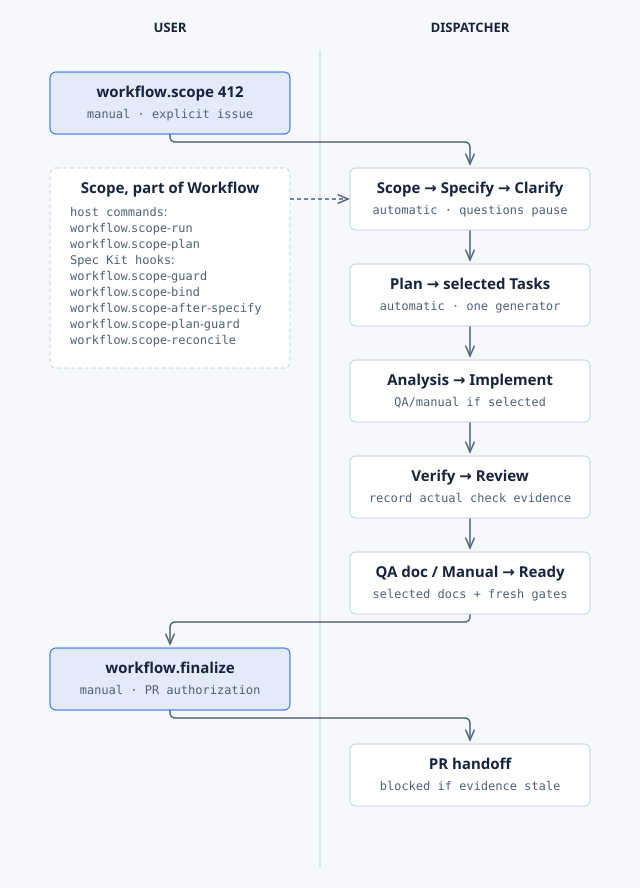
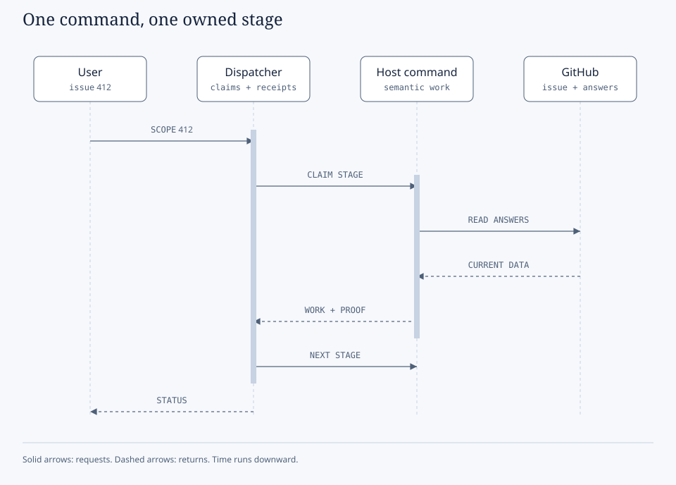
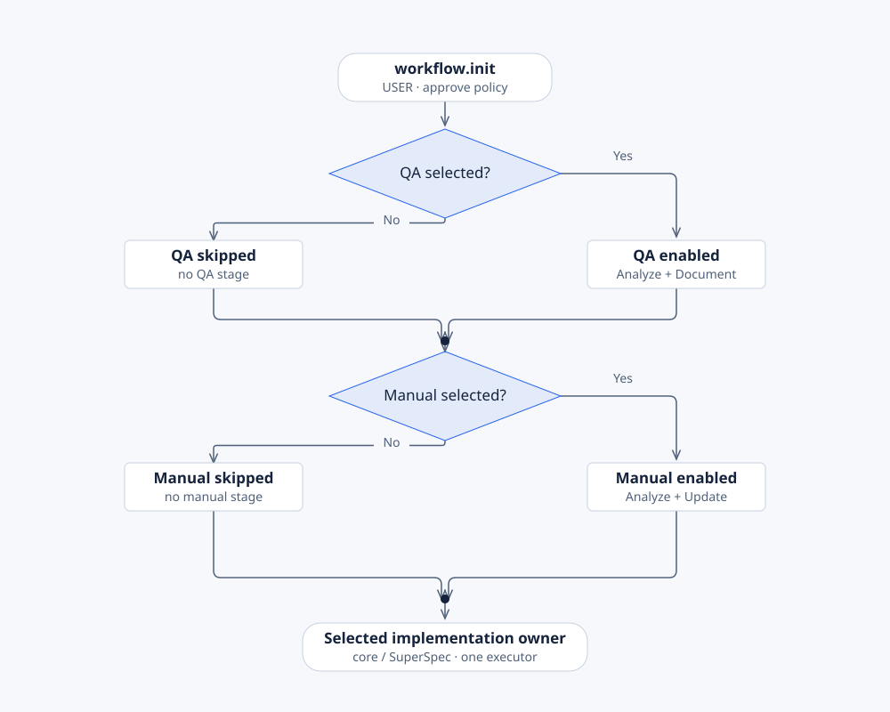
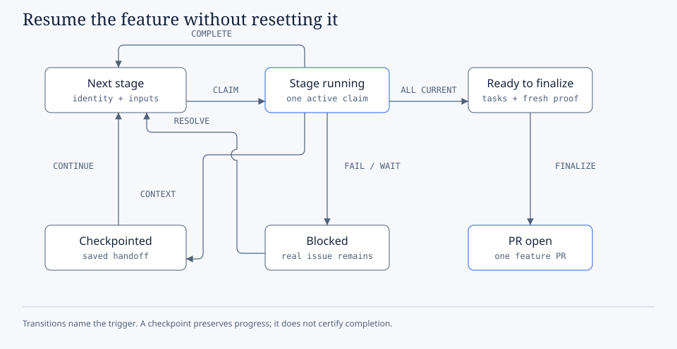

# Managed Workflow

**Goal:** take one GitHub issue from scope to a verified pull request with one command, and resume it
in a new session if you are interrupted.

The [managed Workflow](../reference/glossary.md#managed-workflow) adds a
[dispatcher](../reference/glossary.md#dispatcher). It decides which [stage](../reference/glossary.md#stage)
runs next, takes a [claim](../reference/glossary.md#claim) on it, and checks the
[receipt](../reference/glossary.md#receipt) before it moves on.

## Prerequisites

- A Spec Kit project with the Sanduq catalog registered. See [set up Spec Kit](../start/install-speckit.md).
- Python 3.11 or later (Workflow runs on 3.10; Memory and Progress need 3.11), Git, and `gh` signed
  in with Project scopes. See [prerequisites](../start/prerequisites.md).
- A GitHub Project (v2) board linked to the repository, unless you choose board mode `none`. See
  [board](#board).

## Board

`init --board full|minimal|none` picks how much Workflow writes to the board (`full` when omitted):
`full` moves the card at every phase and creates task sub-issues; `minimal` writes only Ready, In
progress, In review and Done and creates no task sub-issues; `none` needs no board at all.
`doctor` prints the mode as `board_sync`. Changing the mode later never invalidates a feature in
flight. In `full` and `minimal` mode every managed claim checks the board first. Without a
configured board, doctor and claim stop with one error, `PROJECT_NOT_CONFIGURED`, naming
`$speckit-project-init`; a partly mapped board gets `PROJECT_SCOPE_STATUS_MISSING` and
`PROJECT_PHASE_UNMAPPED` codes that name the column each expects. The board's Status field needs
these seven options, spelled exactly like this:

`Backlog`, `Feature Specification`, `Need Clarifications`, `Ready`, `In progress`, `In review`, `Done`

A new GitHub board has `In Progress` with a capital P. Rename it, or let `$speckit-project-init`
create the missing columns (`--auto-create-columns` in the script). Changing columns gives every
option a new id; Project init saves and restores each item's Status while it does this.

## First-run checklist

Follow these in order. Each step links to its detail.

1. Install Spec Kit, Python 3.11 or later, Git and `gh` ([prerequisites](../start/prerequisites.md)).
2. Sign in to GitHub and add the Project scopes:
   `gh auth login`, then `gh auth refresh -h github.com -s project,read:project`.
3. Create the repository and clone it: `gh repo create <owner>/<name> --private --clone`, then
   `cd <name>`. In it, run `specify init --here --integration codex` (or `--integration claude`).
   The clone is not empty, so it asks `Current directory is not empty (2 items) ... [y/N]` (the
   count varies); answer `y`. Then register the Sanduq catalog at priority 1
   ([set up Spec Kit](../start/install-speckit.md)).
4. Create a GitHub Project (v2) and link it to the repository:
   `gh project create --owner <owner> --title "<name>"` prints the board URL, whose last number is
   the board number; then `gh project link <number> --owner <owner> --repo <owner>/<name>`. Do not
   add the Status options by hand: `gh` cannot edit them, and step 7 creates the seven statuses.
5. Run `specify extension add workflow`.
6. Run `$speckit-workflow-init` with your choices (see [install](#install)). The host command runs
   Workflow's installer for you. The script `workflow.py init` does not install anything: until
   `install.py --apply` has run, it prints `ok: false` with `DEPENDENCY_UNAVAILABLE`,
   `SOURCE_MISMATCH`, `COMMAND_UNAVAILABLE` and `PRESET_REQUIRED` errors. They are expected at that
   point; `install.py --apply` clears them.
7. Map the board with required sync:
   `python .specify/extensions/project/scripts/project_init.py --number <number> --hooks-mode required --auto-create-columns`.
   `--auto-create-columns` creates the seven statuses that are missing, and the script maps them to
   the lifecycle phases. Without `--number` the script exits 4 and lists the owner's boards.
8. Run `python .specify/extensions/workflow/scripts/workflow.py doctor --project` until it reports
   `ok: true`.
9. On Codex, approve the guard hook once in `/hooks`. Start a new agent session so the host loads the
   new commands.
10. Create an issue: `gh issue create --title "<what to build>" --body "<details>"` prints its URL;
    the last number is the issue number. Run `$speckit-workflow-scope <number>` on it. The first
    claim has succeeded when Scope starts its analysis of the issue instead of stopping on doctor
    errors; `python .specify/extensions/workflow/scripts/workflow.py status --feature specs/<slug>`
    shows the claim.

## Install

```bash
specify extension add workflow
```

Then initialize. The host command records your choices and runs Workflow's installer, which adds
the extensions it needs.

<details>
<summary>Codex</summary>

```text
$speckit-workflow-init Enable QA and User Manual for the booking application. Use our existing GitHub Project and an advisory managed-only evidence gate.
$speckit-workflow-doctor Verify project readiness and installed host commands.
```

</details>

<details>
<summary>Claude Code</summary>

```text
/speckit-workflow-init Enable QA and User Manual for the booking application. Use our existing GitHub Project and an advisory managed-only evidence gate.
/speckit-workflow-doctor Verify project readiness and installed host commands.
```

</details>

The script equivalent is:

```bash
python .specify/extensions/workflow/scripts/workflow.py init --qa on --manual on --gate-mode advisory --gate-scope managed-only
python .specify/extensions/workflow/scripts/install.py
python .specify/extensions/workflow/scripts/install.py --apply
python .specify/extensions/workflow/scripts/workflow.py doctor --project
```

The script `init` only records the choices; its doctor errors (`DEPENDENCY_UNAVAILABLE`,
`SOURCE_MISMATCH`, `COMMAND_UNAVAILABLE`, `PRESET_REQUIRED`) are expected until `install.py --apply`
has run. The first `install.py` call previews. The second backs up, applies, and rolls back on
failure. If your board is not configured yet, run `$speckit-project-init`. You are ready when
`doctor --project` passes.

The installed evidence gate, `.github/workflows/sanduq-workflow-gates.yml`, runs on GitHub-hosted
runners by default: the CI selection in `.specify/workflow.yml` starts as `policy: hosted-allowed`
with `linux: [ubuntu-latest]`, so the rendered job has `runs-on: ubuntu-latest`. To run it on your
own runners, record the selection before `install.py --apply` (or reinstall after changing it):

```bash
python .specify/extensions/workflow/scripts/workflow.py ci --policy self-hosted-required --linux self-hosted,<label> --system-packages preinstalled --python preinstalled
```

Under `self-hosted-required` the command drops each GitHub-hosted platform you did not name (the
default `windows: [windows-latest]`) and lists it under `dropped_hosted_platforms`; add
`--windows self-hosted,<label>` to keep a Windows job on your own runner.

Never edit the rendered workflow file by hand. The selection and `self-hosted-required`'s recorded
exceptions are in [where your CI actually runs](../workflow/operations.md#where-your-ci-actually-runs).

## First prompt

<details>
<summary>Codex</summary>

```text
$speckit-workflow-scope 412 Assess refund approval using our project policy and continue through implementation. Stop before PR creation.
```

</details>

<details>
<summary>Claude Code</summary>

```text
/speckit-workflow-scope 412 Assess refund approval using our project policy and continue through implementation. Stop before PR creation.
```

</details>

## What you will see



You start `workflow.scope 412`. Scope posts any open questions on the issue. You answer them on
GitHub, then run `workflow.clarify`. The dispatcher runs specification, planning, task generation,
analysis, implementation, verification, review and documentation. When evidence is current, the
feature is ready. `workflow.finalize` opens or updates one pull request.

At implementation start, a live progress report opens at
`specs/412-refund-approval/workflow/progress/index.html`. `workflow.continue` resumes an interrupted
run from its [checkpoint](../reference/glossary.md#checkpoint). It never skips a blocking check.

The [sequence diagram](../diagrams/dispatcher-sequence.html) shows the claim, the host's work and
the receipt check. The [worked lifecycle](../workflow/lifecycle.md) walks through every stage.



## Optional delivery paths



QA and manual selection are independent. Selected QA adds readiness analysis and a walkthrough after
checks. A selected manual adds gap analysis and affected-page updates. Selecting neither keeps the
core stages. [Editable decision flow](../diagrams/delivery-choices.html).

| Choice | Path |
| --- | --- |
| Core executor | Core task generation and implementation |
| SuperSpec installed | SuperSpec generates tasks and executes; no second core executor runs |
| Superpowers Bridge installed | Continuation goes to the current owner; no extra executor runs |
| Questions unresolved | Pause for answers on GitHub, then run Clarify |
| Required check stale or failed | Finalize is blocked until the evidence is repaired |
| PR Generate `--no-pr` | Documents only; no remote PR work |

## State and recovery



A ready feature moves through implementation and verified documentation to a pull request. Open
questions or stale evidence block it until you fix them.
[Editable state diagram](../diagrams/feature-state.html) ·
[status and recovery commands](../workflow/operations.md).

## Next step

- Daily operation, upgrades and recovery: [operating guide](../workflow/operating-guide.md).
- CI gate modes and adding QA or the manual later: [delivery policy](../workflow/delivery-policy.md).
- Every stage and its command: [stages](../workflow/stages.md) and the [hooks reference](../reference/hooks.md#managed-workflow).

## Who enforces dependencies

Workflow's installer adds Scope, Project, PR and Illustrate, plus Assure and User Manual when you
select them. It pins each version in `dependencies.json` and keeps a newer compatible version if you
already have one. Spec Kit itself does not enforce `requires.extensions`.

## Limits

- Merge and deployment need your explicit authorization. Finalize stops at the pull request.
- Workflow disables the extension hooks it owns and runs those commands as stages instead. Do not
  re-enable them by hand. Run `$speckit-workflow-reconcile` to repair the wiring.
- Installing a package does not [enable](../reference/glossary.md#enabled) its process. Init does.
- Context protection relies on the host's measurements. When none are available, the run continues
  and records that the measurement was unavailable.
- Receipts are self-asserted: each stage writes its own receipt into `checkpoint.json`, a local
  JSON file anyone with the checkout can edit, and the delegation ledger's tamper markers only catch
  accidental edits. The CI gate checks that receipts are present, passing and current; with the
  default `advisory` mode it warns and does not block the PR. Set `ci.gate.mode: required` once the
  first feature has passed, and treat the PR review as the control. See
  [SECURITY.md](../../SECURITY.md).
