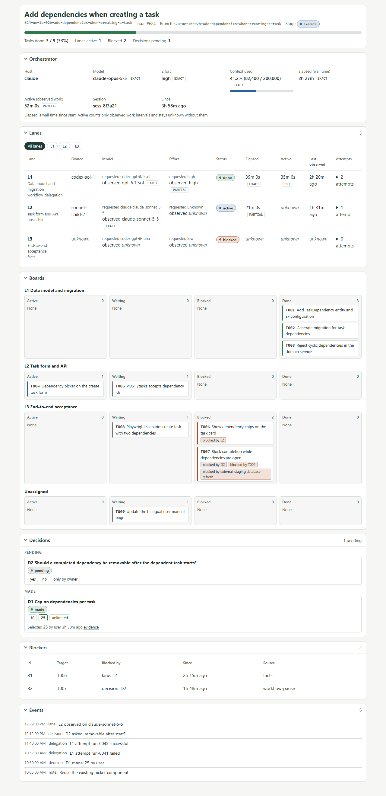
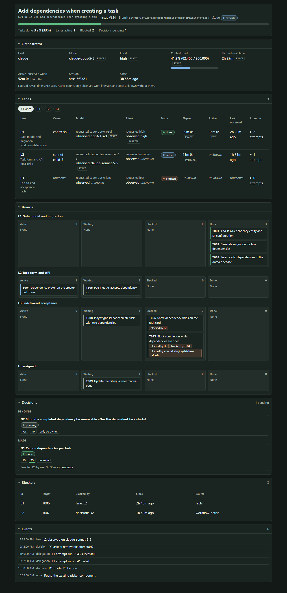
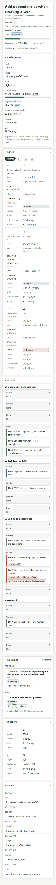

# Sanduq Progress Report

**Purpose:** a live report for one Spec Kit feature: which lanes run which tasks, what is blocked, which decisions
are open, and what the orchestrating agent is using. The report is a deterministic projection. It is rebuilt from the
feature files and the host's native hook payloads, so no agent is spent keeping it up to date.



## Install

```bash
specify extension add progress
```

Requires Spec Kit 1.1.1 or later and Python 3.11 or later. Workflow and Illustrate are optional
([dependencies](dependencies.yml)). Then create the report once the task list exists:

```text
$speckit-progress-init Create the progress report for specs/412-refund-approval.
```

Open `specs/<feature>/progress/.view/index.html` in a browser. It works from `file://`, needs no server and polls
for new data every 3 seconds.

## How it plugs in

| Setup | What feeds the report |
| --- | --- |
| Plain Spec Kit | `tasks.md` (task state, dependencies), native host hooks (model, effort, context, child agents), and a small tracked fact file for what nothing else records: lane assignments, blockers, decisions, notes |
| With Sanduq Workflow | The same, plus Workflow's checkpoint, delegation ledger and decisions. Retries and attempts become attempts of one lane. Decisions come from Workflow, so `progress decide` is refused |

The `after_tasks` hook offers to create the report. The `after_implement` hook offers one forced snapshot; it does
not mean the feature is complete. Five native events keep the report fresh: `session_start`, `pre_tool_use`
(subagent launches), `post_tool_use`, `stop` and `session_end`. Each runs a script-only command that prints nothing.

The agent's part is small. Read [the skill](skills/progress/SKILL.ext.md): record a lane when you assign work, and a
blocker, decision or note when one appears. Everything else is collected. The skill states the rule that matters:
reporting is a deterministic projection, and no agent is spawned, kept, messaged or polled to maintain it.

## Commands

| Command | Use |
| --- | --- |
| `$speckit-progress-init` | Create the report, bind this session, optionally install the status line |
| `$speckit-progress-refresh` | Force a snapshot |
| `$speckit-progress-status` | One-line summary, or `--json` for the projection |
| `$speckit-progress-theme` | Choose a preset, import the Illustrate theme or load a file |
| `$speckit-progress-export` | Write the projection as Markdown or JSON |

The `lane`, `block`, `unblock`, `decide` and `note` verbs run through the CLI described in
[the verb reference](skills/progress/references/verbs.md). The hook commands are internal.

## What is measured, and how well

Every measured value carries its source and fidelity. Unknown is shown as unknown and is never filled with a guess.

| Fact | Claude Code | Codex |
| --- | --- | --- |
| Task state, dependencies | Exact, from `tasks.md` | Exact, from `tasks.md` |
| Lane, blocker, decision, note | Exact, recorded by verb | Exact, recorded by verb |
| Model | Exact from the status line when installed; partial from hooks | Partial, from the rollout file |
| Effort | Exact from hook and status line payloads where the host sends it | Partial, from the rollout file |
| Context use | Exact from the status line | Partial, from the rollout file |
| Elapsed | Session duration from the status line; otherwise estimated from the feature start | Estimated |
| Active work time | Unknown. Hosts give no interval evidence, so it is never inferred | Unknown |
| Child agents | Started on launch, ended on a terminal tool result; a background child stays running until a stop payload names it | Parent links when the payload has them; otherwise dropped and counted |
| Observed child model | Only when the payload carries it | Only when the payload carries it |

Codex field names are partly unverified against a running host; see [hosts](docs/hosts.md) for what was checked and
what was not. A session is bound to a feature by an explicit handshake, so hooks never attach an observation to a
guessed feature.

## Theming

Four presets (`sanduq`, `cobalt`, `emerald`, `classic`) in light and dark, tokens only. `--from-illustrate` maps the
project's Illustrate theme. Block order, hidden blocks, density, title and logo are set in
`.specify/progress/theme.json`.





```text
$speckit-progress-theme Use the cobalt preset.
```

## Token cost

The benchmark replays a 55-update, 24-task, four-lane trace and counts the model-visible content each approach needs.
Counts use `o200k_base`, which is exact for that encoding; Claude figures are unverified because no exact local Claude
tokenizer exists.

| Approach | Updates | Setup |
| --- | ---: | ---: |
| Progress verbs | 1,847 | 631 |
| Hand-edited Markdown report | 59,967 | 581 |
| Legacy Workflow report protocol | 12,092 | 3,957 |

Task start, completion and reopening cost nothing because they are read from `tasks.md`. The full table by update
class, the assumptions and the cl100k_base counts are in [the token benchmark](docs/token-benchmark.md). Measured
usage from real harness runs comes from `scripts/live_ab.py`, which is a manual tool.

## Using with Sanduq Workflow

Progress is optional for Workflow, and Workflow never imports Progress code. It uses only the CLI and versioned JSON.

- **Install.** `python .specify/extensions/workflow/scripts/install.py --with progress --apply`. An installed Progress
  is kept in step on later installs and upgrades. `reconcile` leaves its hooks and events enabled.
- **Instructions.** Workflow's `references/reporting.md` picks `projection` (this extension collects automatically),
  `refresh` (installed, no automatic collection) or `legacy` (absent). In every mode no agent is spawned, kept,
  messaged or polled only to maintain the report.
- **Old calls.** Workflow's `scripts/progress.py` forwards `init`, `task`, `event`, `phase`, `usage`, `sync` and `pr` here
  (`lane`, `attempt record`, `block`, `note`, `refresh`). Usage keeps its explicit log path, time window and reported
  counters as a fact with origin `legacy`; legacy facts never override the ledger. `--json` and `init --title` are
  refused with a compatibility error.
- **Runs.** `progress runs --json` returns schema `progress.runs.v1`, built from `.delegate/runs`. Workflow's lean
  status renders from it. Elapsed time is wall time, `stalled` is a heuristic, and a harness's terminal status is not
  acceptance.

## Contract and hosts

[Contracts](docs/contracts.md) are normative. [Hosts](docs/hosts.md) records how Spec Kit dispatches events and what each
host sends.

## License

PolyForm Noncommercial 1.0.0. See [licenses](../../docs/reference/licenses.md).
